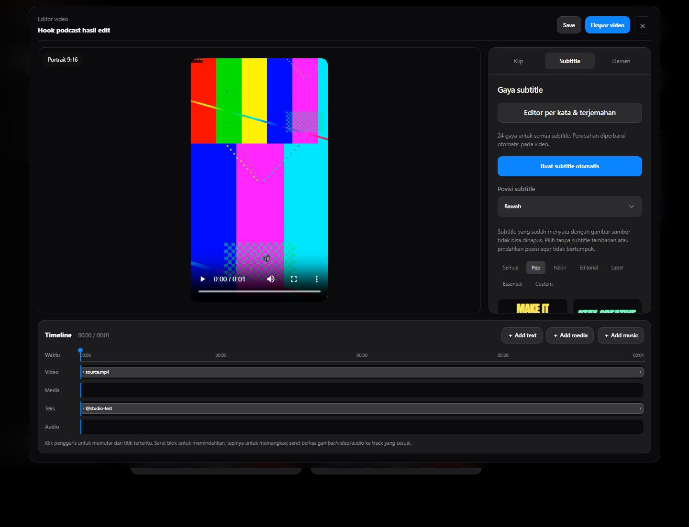

<p align="center"></p>

<p align="center">A simple video studio for Windows and Android. Find moments in long videos, edit them directly, and make captions, voiceovers, and images with local models.</p>

Version 1.12 adds caption-first processing, local GGUF ranking, live subtitle playback, phone rotation handling and source relinking. [Usage, validation and limitations](docs/RELEASE-1.12.0.md).

<p align="center"><a href="https://github.com/Zwart04/Studio-ZAI/releases/latest"><strong>Download v1.12.0</strong></a> · <a href="README.md">Bahasa Indonesia</a> · <a href="docs/FEATURES.md">Platform features</a> · <a href="docs/MODELS.md">Models & licenses</a></p>



## New in 1.11

The editor and manual clips default to portrait. Windows and Android add separate facecam/gameplay crops, opening titles, text/image watermarks, multiple-word styling, active-word boxes, draft caption video previews, and automatic language detection. Podcast detection, keyframed crop, translation, galleries, and batch export remain available. [Feature coverage and limitations](docs/CREATOR.md) · [Release verification](docs/RELEASE-1.11.0.md).

Provider + API key discovers account models and recommends a returned model. Tracking uses YuNet on Windows and ML Kit on Android, holding crop when the selected face disappears. Selected rendered clips can be downloaded/shared as one ZIP. New code permits public use; selling the application or its service requires permission. Creators may monetize their outputs.

## A studio for video, voice, and images

**Auto-clips and editing.** Import a local file or supported URL, select the actual source audio track, and let the adaptive clip selector find the start of a topic or product review. The source stays with the project so you can choose another range without downloading it again. The editor places a playable video beside an inspector and above a timeline. Drag text/media blocks, pull their edges to adjust duration, or drop files onto a track. It supports trim, split, original/9:16/1:1/16:9 canvas, timed captions, and 24 reusable text styles. Automatic captions for a single edit transcribe only that clip when the project has no transcript.

**Local voice.** Ten Supertonic 3 characters synthesize Indonesian and English; Piper LJSpeech offers a lightweight English option. Import any FFmpeg-readable audio file or record a reference with the microphone. ZipVoice clones English/Mandarin. Indonesian cloning is an optional, much heavier Chatterbox setup from desktop source; it is not included in the APK or lightweight EXE. Online OpenAI voices are optional.

**Local images.** SDXS-512 generates 512×512 images on Windows and ARM64 Android after a separate 683 MB model download. Prompts stay on device in local mode. Cloud image generation remains optional.

The installed models work without an API key. Downloading a model or a video URL needs internet, while editing imported files and running local models can be offline. Optional Groq, Gemini, OpenAI, Anthropic, DeepSeek, and compatible endpoints support AI tasks where configured.

## Download

| Platform | Package | Notes |
| :-- | :-- | :-- |
| Windows 10/11 x64 | [Windows ZIP](https://github.com/Zwart04/Studio-ZAI/releases/download/v1.12.0/StudioZAI-1.12.0-windows-x64.zip) | Extract the whole folder and run **StudioZAI.exe**. FFmpeg and AI runtimes are bundled; model weights are installed separately. |
| Android 8+ | [One universal APK](https://github.com/Zwart04/Studio-ZAI/releases/download/v1.12.0/StudioZAI-1.12.0-android.apk) | Local image inference requires ARM64. |

[Release validation](docs/RELEASE-1.12.0.md) · [SHA-256 checksums](https://github.com/Zwart04/Studio-ZAI/releases/download/v1.12.0/SHA256SUMS.txt) · [Build guide](docs/BUILD.md)

## Get started

1. Complete the initial setup and install a speech recognition model. Whisper Base is a good starting point; Small may improve Indonesian accuracy if the device has enough RAM. Add voice and image models only when needed.
2. Paste a link or choose a local video. Put **content language** beside **source audio track**; the transcript language does not translate the audio. Android accepts public YouTube links and direct video URLs. Import a downloaded file for TikTok/Instagram on Android; desktop uses sites supported by yt-dlp.
3. Choose a clip count and generate. With **AI subtitles from audio** enabled, local Whisper transcribes the soundtrack; captions supplied by the URL are not imported. Open a clip, play and refine it in the editor, then export. Use **Take a range from source** to create another clip without downloading again.

A **transcript** is speech text used to find moments; **captions** are timed text shown on the video. If the source already contains burned-in text, disable or reposition the extra captions. Supertonic offers ten voice characters for Indonesian/English synthesis; it does not clone a speaker.

The [model catalog](docs/MODELS.md) identifies commercial-use restrictions and uncertain voice-data rights. Supertonic is **open weights under OpenRAIL-M**, not OSI open source; commercial use has conditions. Older restricted or unverified Piper voices remain visible for removal but are not recommended for new projects.

## See the app


| Home | Voice | Images |
| :--: | :--: | :--: |
|  |  |  |

These screenshots show the desktop web UI with documentation media. The [narrow home](docs/screenshots/05-mobile-home.jpg) and [narrow editor](docs/screenshots/09-mobile-editor.jpg) test responsive web layout, not the APK. The GIF is a UI tour; release downloads contain no demo MP4.

Clip selection was checked against a [real 80.5-minute speaker review](https://youtu.be/4WvlolSYqjU). [The validation report](docs/RELEASE-1.8.0.md) gives the exact coverage and limits. A physical Android device was not available for end-to-end testing in this session. Image generation speed and memory use depend on the device; ARM32 does not have a native local image engine. Private, region-blocked, or login-only video URLs may fail.

## Development

```powershell
git clone https://github.com/Zwart04/Studio-ZAI.git
cd Studio-ZAI
python -m venv .venv
.venv/Scripts/python.exe -m pip install -e "core[media,asr,tts,face,translation,desktop,dev]"
.venv/Scripts/python.exe -m studiozai serve
.venv/Scripts/python.exe -m pytest core/tests
```

```powershell
cd android/app
flutter pub get
flutter analyze
flutter test
flutter build apk --release
```

[Models and licenses](docs/MODELS.md) · [AI setup](docs/AI.md) · [Features by platform](docs/FEATURES.md) · [Architecture](docs/ARCHITECTURE.md)

Application code: [Studio ZAI Noncommercial](LICENSE). Dependencies, fonts, and model weights retain their respective licenses. Workflow references: [openshorts](https://github.com/mutonby/openshorts) and [OpenCreator](https://github.com/krillinai/OpenCreator).
