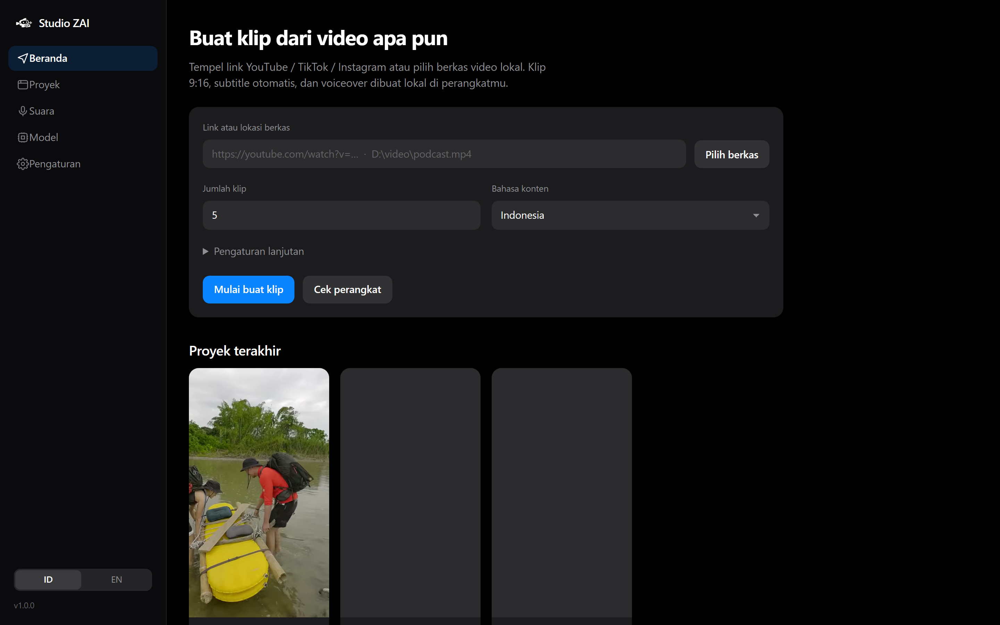
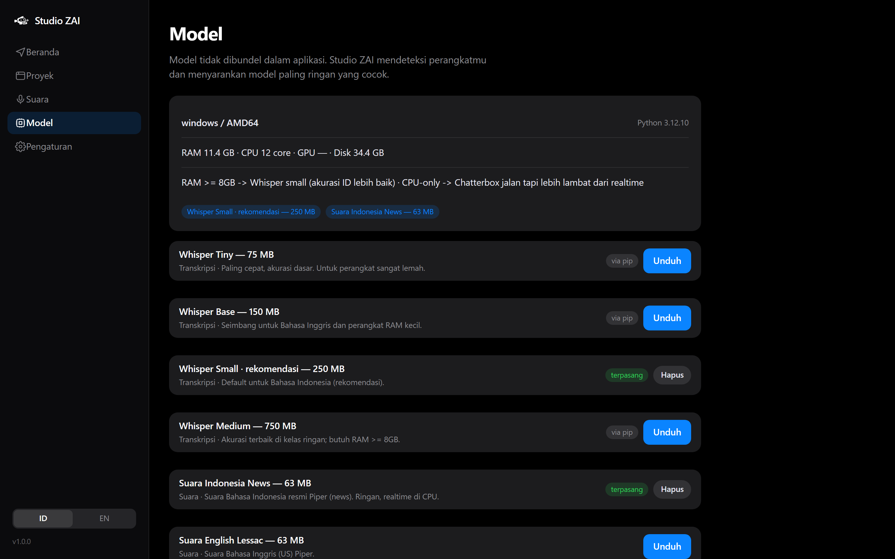
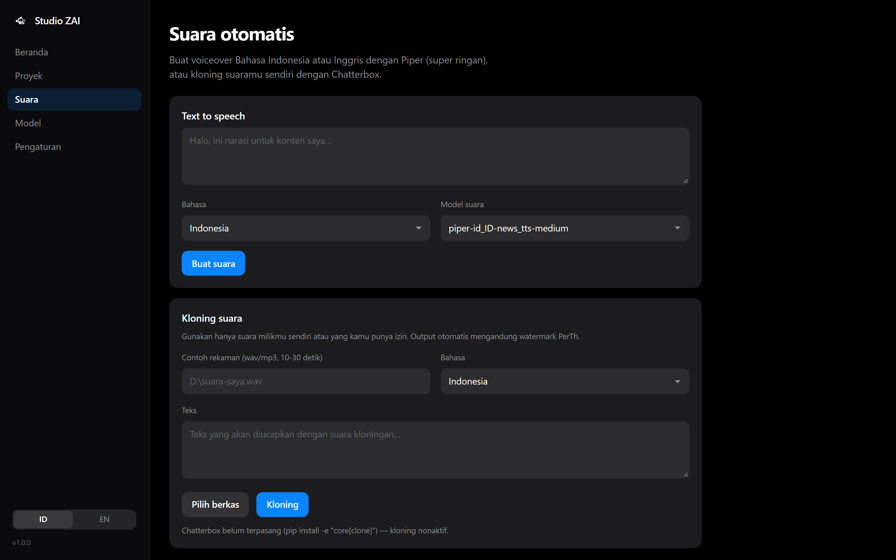
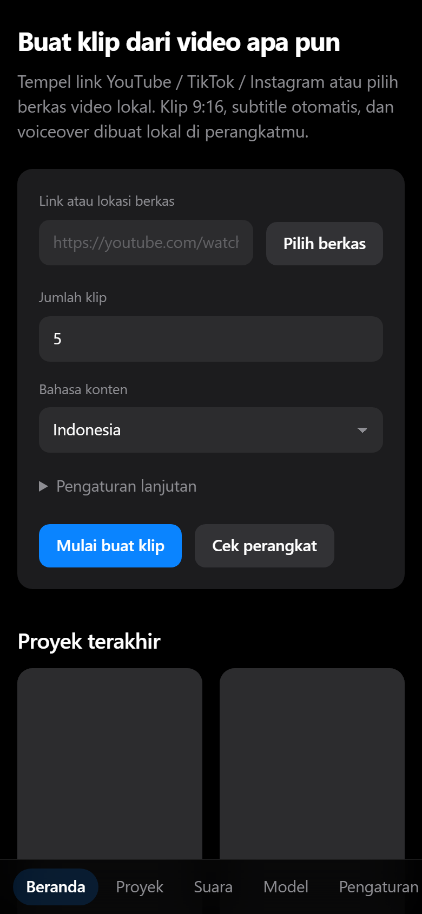

<p align="center">
  
</p>

<h1 align="center">Studio ZAI</h1>

<p align="center">
  <strong>Turn long videos into viral 9:16 clips — automatically, locally, no cloud.</strong><br />
  Smart auto-clip · ID/EN subtitles · voiceover &amp; voice cloning · 100% on-device.
</p>

<p align="center">
  <a href="https://github.com/Zwart04/Studio-ZAI/releases/latest"></a>
  
  
  
</p>

<p align="center">
  <a href="#️-download--try-in-2-minutes"><strong>⬇️ Download &amp; try (2 minutes)</strong></a> ·
  <a href="#-screenshots">📸 Screenshots</a> ·
  <a href="#-features">✨ Features</a> ·
  <a href="#️-how-it-works">⚙️ How it works</a> ·
  <a href="README.md">🇮🇩 Bahasa Indonesia</a>
</p>

---

## 🎬 How it works

Paste a YouTube / TikTok / Instagram link (or pick a local file) → Studio ZAI downloads it, finds the best moments, cuts 9:16 clips, and burns in subtitles automatically — all on your own machine.

| Home — paste a link, pick quality, start | Model Manager — detects hardware, downloads once |
|---|---|
|  |  |

| Voice — ID/EN TTS + voice cloning | Mobile view — bottom tabs, one-handed |
|---|---|
|  |  |

## ⬇️ Download & try (2 minutes)

**Latest release: [github.com/Zwart04/Studio-ZAI/releases/latest](https://github.com/Zwart04/Studio-ZAI/releases/latest)**

| Platform | File | Size |
|---|---|---|
| 🪟 Windows 10/11 (x64) | `StudioZAI-*-windows-x64.zip` — unzip, run `StudioZAI.exe` (FFmpeg bundled) | ±215 MB |
| 🤖 Android 8+ (arm64) | `StudioZAI-*-android-arm64.apk` — targets Android 17 (API 37) | ±42 MB |

AI models are **not** bundled. On first launch a setup wizard downloads what you need (e.g. Indonesian voice ±63 MB). After that, everything runs **offline**.

> 💡 Windows SmartScreen may appear (the EXE is not code-signed yet) → *More info → Run anyway*.
> Android: allow *Install unknown apps* from your browser/file manager.

## ✨ Features

- 🔗 **Any input** — YouTube links (with quality picker 480p → 4K / audio-only), TikTok, Instagram, or local video files. Realtime download progress (MB/s + ETA).
- ✂️ **Genuinely smart auto-clip** — energy + word-density + natural-pause scoring (learned from [openshorts](https://github.com/mutonby/openshorts)): cuts always land on speech pauses, never mid-word. Works with zero AI (pure ffmpeg) or with transcript/local-LLM help.
- 💬 **Automatic subtitles** — word-level → clean captions burned into the video (Clean / Bold-Highlight styles), plus SRT/VTT export. Indonesian & English.
- 📱 **Posting-ready 9:16 clips** — center or blur-background crop, 1080×1920, for TikTok / Reels / Shorts.
- 🎙️ **Automatic voiceover** — type text → natural Indonesian/English voice (Piper, realtime on CPU).
- 🧬 **Voice cloning** — from a 10–30 s sample (desktop: Chatterbox ID+EN; Android: on-device ZipVoice EN). Only for your own voice / with explicit permission.
- 🎛️ **Simple editor** — trim, split, reorder, edit subtitle text, adjust volume, re-render. A first-run wizard guides you from zero to ready.
- 🌗 **Minimal dark UI** — Indonesian + English, one-hand friendly on phones.

## ⚙️ How it works

```
link / local file
   │  yt-dlp (quality picker + MB/s progress)
   ▼
source video ──► Whisper transcript (word timestamps, ID/EN)
   │                  │
   │                  ▼
   │           moment scoring: energy + word density + natural pauses
   │           cuts snap to speech pauses (snap-to-pause)
   ▼
9:16 clips ──► subtitles burned in ──► (optional) voiceover/TTS/cloning ──► posting-ready MP4
```

Everything is local. No telemetry, no uploads — your videos and voice never leave the device. Details: [docs/ARCHITECTURE.md](docs/ARCHITECTURE.md).

## 🪶 Why so light?

| Decision | Effect |
|---|---|
| Runs **without AI** (ffmpeg heuristics + audio scoring) | Even weak laptops can make clips |
| Smallest-in-class models: Whisper tiny–small (75–250 MB), Piper (~60 MB/voice) | Small downloads, CPU-only, realtime |
| Models **not bundled** — on-demand via the Model Manager | Installer/APK stay small |
| Vanilla UI (desktop) + lean Flutter (Android) | Low idle RAM, fast startup |

## 🚀 For developers

```bash
# Desktop: run from source
git clone https://github.com/Zwart04/Studio-ZAI.git
cd Studio-ZAI/core
pip install -e .[dev]
studiozai doctor     # check ffmpeg, GPU, model recommendations
studiozai serve      # open http://127.0.0.1:8737
```

```bash
# Android: build the APK (needs Flutter + Android SDK 37)
cd android/app
flutter pub get
flutter build apk --release --split-per-abi
```

```bash
# Tests
cd core && pytest -q        # 40 unit tests
flutter analyze             # inside android/app
```

Full build guide (Windows EXE via PyInstaller, AppImage, APK signing):
[docs/BUILD.md](docs/BUILD.md) · Architecture: [docs/ARCHITECTURE.md](docs/ARCHITECTURE.md) ·
Models: [docs/MODELS.md](docs/MODELS.md) · Full feature list: [docs/FEATURES.md](docs/FEATURES.md)

## 🗂️ Repo layout

```
Studio ZAI/
├─ core/       # Python engine: pipeline, CLI, server, model manager
├─ ui/         # Static web UI (desktop)
├─ desktop/    # pywebview launcher + packaging (PyInstaller/AppImage)
├─ android/    # Flutter app (full on-device)
├─ assets/     # Official logo
├─ docs/       # Documentation + screenshots
├─ scripts/    # Dev & deploy scripts
└─ tools/      # Utilities (icon generator, screenshots)
```

## ⚖️ License & attribution

Studio ZAI code: **MIT** — see [LICENSE](LICENSE).

Third-party models: Piper (MIT) · Whisper / faster-whisper (MIT) · Chatterbox (MIT) ·
Chatterbox-TTS-Indonesian (Apache-2.0) · ZipVoice via sherpa-onnx (Apache-2.0).
Details & official links: [docs/MODELS.md](docs/MODELS.md).
Pipeline inspiration: [openshorts](https://github.com/mutonby/openshorts) (snap-to-pause, scoring) &
[OpenCreator](https://github.com/krillinai/OpenCreator) (local creator workspace).

> ⚠️ Voice cloning is only for your own voice or voices you have explicit permission to use.
> Chatterbox outputs automatically carry the PerTh watermark (model default, MIT).
