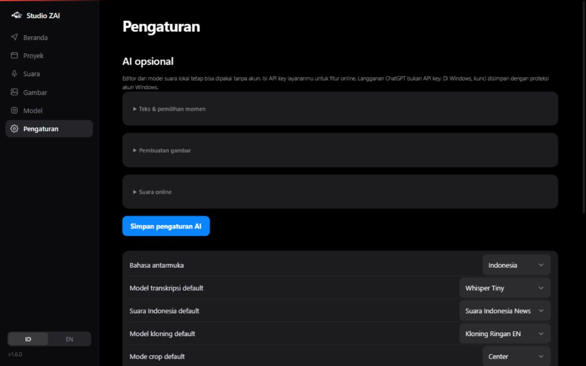

<p align="center"></p>
<p align="center">Studio kreatif sederhana untuk Windows dan Android.<br />Edit video, susun subtitle, buat suara, dan ubah ide menjadi gambar.</p>
<p align="center"><a href="https://github.com/Zwart04/Studio-ZAI/releases/latest"><strong>Unduh v1.6.0</strong></a> · <a href="#mulai">Mulai</a> · <a href="docs/MODELS.md">Model & AI</a> · <a href="docs/BUILD.md">Build</a> · <a href="README.en.md">English</a></p>


## Satu studio, tiga cara berkarya

- **Video:** ambil bagian mana pun dari video yang tersimpan, trim, split, pilih kanvas, edit subtitle, tambahkan teks, media, dan musik.
- **Suara:** narasi Indonesia atau Inggris, pilihan karakter suara lokal/online, rekaman mikrofon, dan kloning ZipVoice untuk English/Mandarin.
- **Gambar:** tulis prompt, buat gambar melalui OpenAI atau hubungkan server Stable Diffusion lokal, lalu simpan hasilnya.

Model lokal diunduh sesuai kebutuhan. Editor, subtitle, dan suara lokal tidak memerlukan akun cloud setelah model terpasang. Fitur online bersifat opsional dan menggunakan API key milikmu.

## Unduh

| Perangkat | Paket | Cara pakai |
| :-- | :-- | :-- |
| Windows 10/11 · x64 | [Unduh ZIP Windows](https://github.com/Zwart04/Studio-ZAI/releases/download/v1.6.0/StudioZAI-1.6.0-windows-x64.zip) | Ekstrak seluruh folder, lalu buka **StudioZAI.exe**. FFmpeg dan runtime AI sudah ikut. |
| Android 8+ | [Unduh APK Android](https://github.com/Zwart04/Studio-ZAI/releases/download/v1.6.0/StudioZAI-1.6.0-android.apk) | Satu APK universal untuk ARM64, ARMv7, dan x86_64. Model diunduh dari dalam aplikasi. |

[Catatan rilis & hasil pengujian](docs/RELEASE-1.6.0.md) · [SHA-256](https://github.com/Zwart04/Studio-ZAI/releases/download/v1.6.0/SHA256SUMS.txt)

Satu APK memudahkan pemasangan, tetapi ukurannya lebih besar karena memuat beberapa arsitektur. Kebutuhan RAM dan waktu proses bergantung pada model serta panjang video. Linux tersedia melalui source; iOS belum tersedia.

## Mulai

1. **Siapkan model.** Ikuti setup awal. Whisper Base cocok untuk mencoba; Small lebih disarankan untuk subtitle Indonesia jika perangkat memadai. Pilih suara Piper sesuai bahasa.
2. **Masukkan video.** Tempel link atau pilih berkas. Untuk dub Indonesia, pilih **track audio Indonesia** yang tersedia. Buka **Opsi klip** jika ingin mengubah ukuran, durasi, dan subtitle.
3. **Buat dan edit.** Buka proyek → **Edit**. Potong durasi, pisahkan klip, pilih tipografi, atau simpan gaya buatanmu. Video langsung bisa diputar dan diperbarui otomatis; pilih **Ekspor video** untuk hasil akhir.
4. **Gunakan lagi sumbernya.** Tombol **Ambil bagian dari video sumber** membuka video tersimpan; tentukan detik mulai/selesai tanpa mengunduh ulang.

> **Audio, transkrip, dan subtitle:** bahasa konten membantu model mengenali ucapan; tidak menerjemahkan audio. Transkrip adalah teks ucapan. Subtitle adalah teks bertiming yang tampil di video. Pemutar tidak lagi menampilkan caption kedua di atas subtitle yang sudah dirender. Jika sumbernya sudah memiliki teks yang menyatu dengan gambar, pilih **Tanpa subtitle tambahan** atau pindahkan posisinya.

## Lihat alurnya


*Pratinjau berurutan dari UI desktop v1.6.0 dengan media demo buatan sendiri. Tidak ada berkas demo MP4 yang perlu diunduh.*

| Beranda | Studio suara |
| :--: | :--: |
|  |  |

| Studio gambar | Pengaturan AI |
| :--: | :--: |
|  |  |

Screenshot berasal dari aplikasi web desktop. [Tampilan layar kecil](docs/screenshots/05-mobile-home.jpg) merupakan uji responsif web, bukan screenshot APK.

## Model dan layanan

| Kebutuhan | Pilihan |
| :-- | :-- |
| Subtitle ID/EN | Whisper Tiny, Base, Small, Medium; tersedia sesuai perangkat. Small disarankan untuk Indonesia; Tiny lebih cepat tetapi perlu lebih banyak koreksi. |
| Suara lokal | Piper: News (ID), Lessac, Alba, Amy, Ryan, Joe, LJ (EN). Pilih bahasa untuk melihat suara yang cocok. |
| Kloning lokal | ZipVoice int8, English/Mandarin; perlu audio contoh **beserta teks ucapan yang sesuai**. Runtime termasuk Windows dan Android. |
| Pemilihan momen AI | OpenAI, Anthropic, DeepSeek, atau API kompatibel/Ollama. Atur provider, nama model, alamat, dan API key. |
| Suara online | OpenAI, 13 karakter suara; mendukung teks Indonesia/Inggris. |
| Gambar | OpenAI atau server **stable-diffusion.cpp** dengan model pilihan sendiri. Lokal memerlukan pemasangan server terpisah. |

**Gambar lokal belum berjalan sebagai mesin native di APK.** Android dapat memakai layanan online atau server milikmu melalui HTTPS. Tidak ada model gambar berkualitas yang dijamin ringan dan lancar pada semua perangkat; karena itu bobot gambar tidak dibundel dan tidak diunduh otomatis. [Panduan AI dan batasannya](docs/AI.md).

Kunci disimpan dengan proteksi akun Windows pada paket Windows dan secure storage Android. Berkas lokal tetap diproses di perangkat; ketika fitur online dipilih, teks/prompt dikirim ke provider. Langganan aplikasi ChatGPT berbeda dari akses API.

## Keandalan dan batasan

- Unduhan Android memiliki batas waktu, percobaan ulang terbatas, serta pembaruan URL stream tanpa mengganti track bahasa. Pesan kegagalan ditampilkan jika sumber memang tidak tersedia.
- Progres transkripsi video panjang menampilkan bagian yang sedang diproses. Perbaikan SSE mengatasi progres yang berhenti diperbarui setelah banyak segmen.
- Video sumber tersimpan bersama proyek. Hapus proyek untuk membuang sumber dan hasil miliknya; **Bersihkan cache** hanya membuang data sementara. Berkas asli di luar proyek tidak dihapus.
- YouTube dapat mengubah akses stream. Video privat, dibatasi, dihapus, atau membutuhkan login tetap dapat gagal; file lokal menjadi alternatif.
- Versi ini diuji dengan unduhan lengkap video **78 menit** ber-track Indonesia dan transkripsi beberapa chunk setelah menit 60. Rincian, termasuk batas uji perangkat, ada di [laporan validasi](docs/RELEASE-1.6.0.md).
- HP fisik dan API cloud berbayar belum diuji langsung pada rilis ini. Fitur mikrofon Android memerlukan izin perangkat. Tetap buka aplikasi selama pemrosesan panjang.

## Pengembangan

```bash
git clone https://github.com/Zwart04/Studio-ZAI.git
cd Studio-ZAI
python -m venv .venv
# Aktifkan virtualenv, lalu:
pip install -e "core[media,asr,tts,desktop,dev]"
studiozai serve
```

```bash
python -m pytest core/tests
cd android/app
flutter pub get
flutter analyze
flutter test
flutter build apk --release
```

[Arsitektur](docs/ARCHITECTURE.md) · [Fitur per platform](docs/FEATURES.md) · [Model & lisensi](docs/MODELS.md) · [Build & signing](docs/BUILD.md) · [Changelog](docs/CHANGELOG.md)

## Kredit

UI mengikuti [design system](docs/DESIGN.md) yang netral dengan aksen biru. Warna kreatif berada di dalam template video. Kode aplikasi berlisensi [MIT](LICENSE); library, font, dan bobot model mengikuti lisensi masing-masing. Dibangun dengan FFmpeg, yt-dlp, faster-whisper, Piper, Flutter, dan sherpa-onnx. Referensi alur kreator: [openshorts](https://github.com/mutonby/openshorts) dan [OpenCreator](https://github.com/krillinai/OpenCreator).
