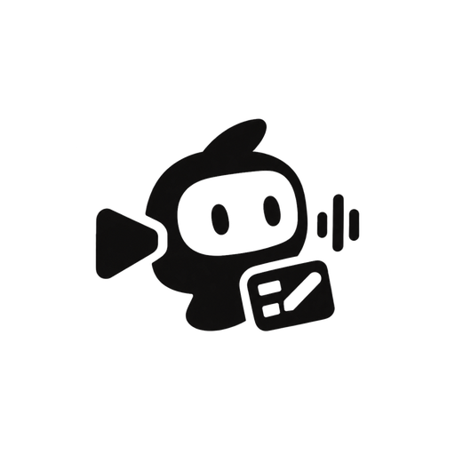
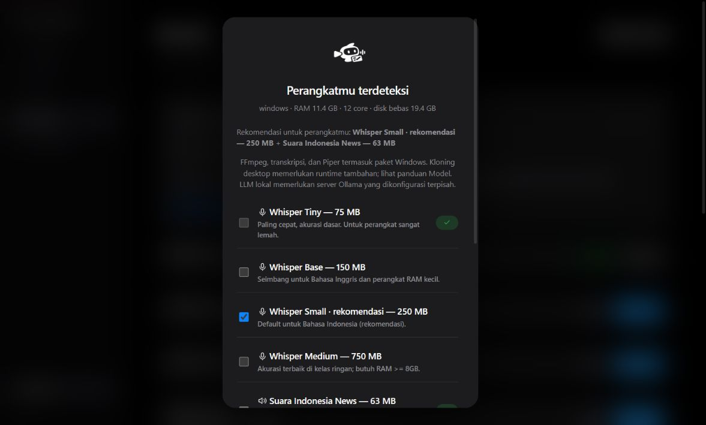

<p align="center">
  
</p>
<h1 align="center">Studio ZAI</h1>
<p align="center"><strong>Dari video panjang menjadi cerita pendek.</strong><br />Klip otomatis, subtitle, editor timeline, dan voiceover — diproses di perangkatmu.</p>
<p align="center">
  <a href="https://github.com/Zwart04/Studio-ZAI/releases/latest"></a>
  
  
  <a href="LICENSE"></a>
</p>
<p align="center"><a href="https://github.com/Zwart04/Studio-ZAI/releases/latest"><strong>Unduh aplikasi</strong></a> · <a href="#lihat-studio-zai">Lihat demo</a> · <a href="#mulai-dalam-3-langkah">Mulai</a> · <a href="docs/BUILD.md">Panduan build</a> · <a href="README.en.md">English</a></p>

## Lihat Studio ZAI


**Satu ruang kerja untuk video, teks, media, dan audio.** Pilih kanvas, atur waktu, buat subtitle otomatis, lalu periksa hasil melalui **Pratinjau cepat** sebelum render akhir.


*Rekaman singkat UI desktop v1.5.1 menggunakan media demo sintetis. Caption hasil transkripsi dapat dikoreksi di editor. [Unduh video demo MP4](https://github.com/Zwart04/Studio-ZAI/releases/download/v1.5.1/StudioZAI-1.5.1-demo.mp4).*

## Unduh

| Platform | Paket | Cara menjalankan |
| :-- | :-- | :-- |
| Windows 10/11 · x64 | [ZIP Windows](https://github.com/Zwart04/Studio-ZAI/releases/download/v1.5.1/StudioZAI-1.5.1-windows-x64.zip) | Ekstrak **seluruh folder**, lalu buka `StudioZAI.exe`. FFmpeg sudah dibundel. |
| Android 8+ · arm64 | [APK arm64](https://github.com/Zwart04/Studio-ZAI/releases/download/v1.5.1/StudioZAI-1.5.1-android-arm64.apk) | Pilihan utama untuk HP Android modern. |
| Android · ARM 32-bit | [APK ARMv7](https://github.com/Zwart04/Studio-ZAI/releases/download/v1.5.1/StudioZAI-1.5.1-android-armv7.apk) | Untuk perangkat ARM 32-bit yang kompatibel. |
| Android · x86_64 | [APK x86_64](https://github.com/Zwart04/Studio-ZAI/releases/download/v1.5.1/StudioZAI-1.5.1-android-x86_64.apk) | Untuk perangkat atau emulator x86_64. |

[Catatan rilis](https://github.com/Zwart04/Studio-ZAI/releases/tag/v1.5.1) · [SHA-256 paket](https://github.com/Zwart04/Studio-ZAI/releases/download/v1.5.1/SHA256SUMS.txt)

Model AI diunduh terpisah melalui setup awal. Internet dibutuhkan untuk unduhan model dan media daring; pemrosesan file lokal berjalan offline setelah model terpasang. Linux tersedia dari source; paket Linux tidak disertakan dalam rilis ini.

## Mulai dalam 3 langkah

1. **Selesaikan setup awal.** Pasang model transkripsi dan suara. Android juga menyiapkan deteksi ucapan; kloning Inggris dapat disertakan. Setup tidak menganggap unduhan gagal sebagai selesai.
2. **Masukkan video.** Pilih file lokal atau link yang didukung. Atur bahasa transkrip, jumlah klip, dan kanvas: **9:16**, **Asli**, **1:1**, atau **16:9**.
3. **Edit dan ekspor.** Buka klip → **Edit** → buat subtitle otomatis, koreksi teks, pilih tipografi, dan tambahkan track. Klik **Pratinjau cepat**, kemudian **Ekspor video** untuk menerapkan perubahan ke video akhir.

> **Transkrip, subtitle, dan audio berbeda.** Transkrip adalah teks ucapan yang dikenali dari audio. Subtitle menempatkan teks itu pada waktu tertentu di video. Memilih bahasa transkrip tidak menerjemahkan ucapan atau mengganti suara. Untuk dub Indonesia di YouTube, pilih **track audio Indonesia** yang memang tersedia pada video sumber.

## Yang bisa kamu kerjakan

| Fitur | Hasil |
| :-- | :-- |
| Pemilihan klip otomatis | Momen dipilih berdasarkan energi audio, kepadatan ucapan, dan jeda. |
| Editor timeline | Atur track video, gambar/video tambahan, teks, dan audio. |
| Subtitle otomatis | Transkripsi Whisper ID/EN, koreksi caption, dan subtitle yang dibakar ke MP4. |
| 24 template tipografi | Essential, Pop, Neon, Editorial, dan Label dengan font serta warna berbeda; preset posisi 3 × 3 dan koordinat presisi. |
| Kanvas dan framing | Ukuran asli, portrait, kotak, landscape; center crop, fit, atau latar blur. |
| Voiceover lokal | Piper Indonesia dan Inggris; hasil dapat digunakan sebagai narasi. |
| Audio multibahasa | Pilih track audio YouTube yang tersedia, tanpa diam-diam kembali ke bahasa lain. |
| Model sesuai kebutuhan | Unduh sekali, lihat status pemasangan, dan gunakan kembali secara lokal. |

## Tampilan aplikasi

| Beranda | Model |
| :--: | :--: |
|  |  |

| Voiceover | Setup awal |
| :--: | :--: |
|  |  |

Screenshot diambil dari UI desktop. Tampilan web pada layar kecil tersedia di [screenshot responsif](docs/screenshots/05-mobile-home.png); gambar tersebut bukan screenshot APK.

## Teruji pada video panjang

Rilis ini diuji dengan video YouTube **78 menit 6 detik** yang memiliki track audio Indonesia: unduhan lengkap 480p, transkripsi 1.874 segmen, pemilihan tiga klip otomatis, serta ekspor dan pratinjau dari awal, setelah menit 60, dan mendekati akhir video. Ukuran asli, kotak, dan portrait diperiksa dengan FFprobe. [Rincian validasi](docs/RELEASE-1.5.1.md).

## Dukungan dan batasan

- **Sumber video:** desktop memakai yt-dlp untuk YouTube, TikTok, Instagram, dan situs yang didukung library. Android mendukung YouTube, URL file media langsung, dan file lokal. Akses situs dapat berubah atau memerlukan autentikasi.
- **Kloning suara:** Android menggunakan ZipVoice untuk Inggris. Desktop memerlukan runtime Chatterbox tambahan dari instalasi source; paket Windows standar tidak membundel PyTorch/Chatterbox. Setup menjelaskan dependensi ini. Gunakan rekaman yang kamu miliki atau diizinkan untuk digunakan.
- **LLM lokal:** opsional di desktop dan memerlukan server kompatibel, misalnya Ollama, yang dikonfigurasi terpisah.
- **Akurasi subtitle:** bergantung pada model, bahasa, kebisingan, dan pelafalan. Tinjau teks sebelum publikasi; model kecil mengutamakan kecepatan.
- **Rilis Android:** APK ditandatangani dengan konfigurasi sideload proyek. Pengujian v1.5.1 mencakup build, analisis Flutter, dan tes otomatis; pengujian pada HP fisik belum dilakukan dalam rilis ini.

## Pengembangan

```bash
git clone https://github.com/Zwart04/Studio-ZAI.git
cd Studio-ZAI
python -m venv .venv
# Aktifkan virtualenv, lalu:
pip install -e "core[media,asr,tts,desktop,dev]"
studiozai serve
```

```bash
# Tes engine dan render (FFmpeg/FFprobe harus tersedia)
python -m pytest core/tests

# Android
cd android/app
flutter pub get
flutter analyze
flutter test
flutter build apk --release --split-per-abi
```

[Build dan signing](docs/BUILD.md) · [Arsitektur](docs/ARCHITECTURE.md) · [Model dan lisensi](docs/MODELS.md) · [Fitur](docs/FEATURES.md) · [Validasi v1.5.1](docs/RELEASE-1.5.1.md)

## Lisensi dan kredit

Antarmuka mengikuti [design system Apple-style](docs/DESIGN.md): palet netral dan aksen biru bawaan. Warna kreatif berada pada template video. Font Anton, Barlow Condensed, DM Serif Display, dan Kalam dibundel dengan lisensi OFL di `ui/assets/fonts/` serta `android/app/assets/fonts/`.

Kode Studio ZAI menggunakan [MIT](LICENSE). Model dan library mengikuti lisensinya masing-masing; lihat [MODELS.md](docs/MODELS.md). Dibangun dengan FFmpeg, yt-dlp, faster-whisper, Piper, Flutter, dan sherpa-onnx. Inspirasi alur kreator: [openshorts](https://github.com/mutonby/openshorts) dan [OpenCreator](https://github.com/krillinai/OpenCreator).
