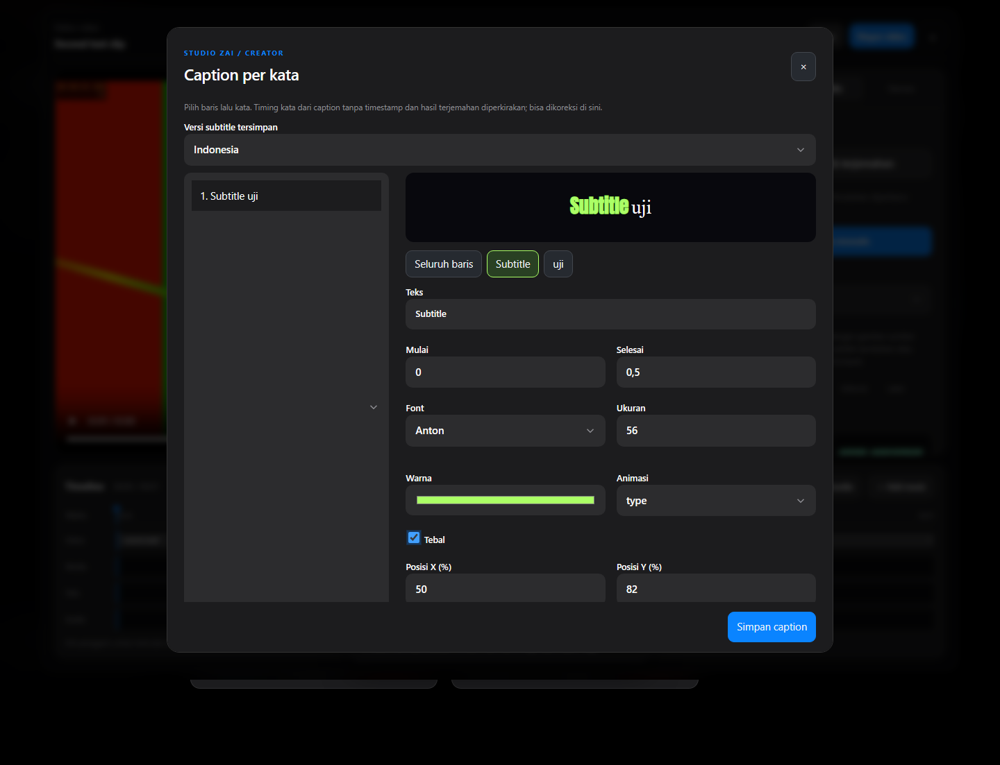
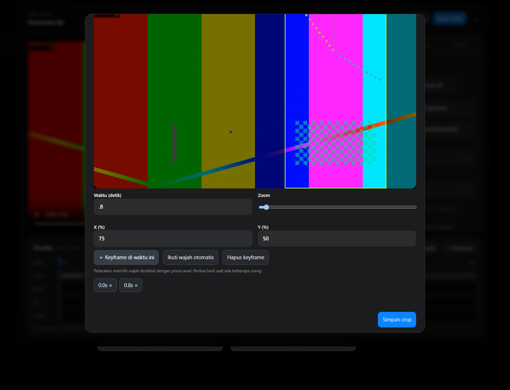

# Studio ZAI 1.9 — Windows & Android

Alur creator mengacu pada fitur publik [SocialVisuals](https://socialvisuals.pro/), diperiksa 29 September 2026. Implementasi, merek, font, dan kode memakai aset Studio ZAI sendiri.

## Pemetaan fitur

| Kemampuan | Windows | Android |
|---|---|---|
| Impor sumber lokal / link | Pemilih native, upload browser, drag/drop; yt-dlp | Pemilih berkas; YouTube / URL media langsung |
| Analisis lokal tanpa API key | Audio, transkrip, topik, mode podcast | Audio streaming, transkrip, topik, mode podcast |
| Deteksi podcast | Tanya-jawab, hook, cerita, poin utama, penalti promosi | Kriteria yang sama |
| Jumlah otomatis | 3–10 target sesuai panjang sumber; boleh lebih sedikit | Sama |
| Ranking AI opsional | Groq, Gemini, OpenAI, Anthropic, DeepSeek, endpoint kompatibel | Sama |
| Podcast panjang lewat AI | Transkrip dipecah, hasil divalidasi dan deduplikasi | Sama |
| Review sebelum render | Draf, skor/alasan, judul/hook editable | Sama |
| Caption per kata | Teks, timing, font, ukuran, warna, tebal | Sama; timestamp token Whisper diaktifkan |
| Animasi | None, pop, fade, rise, zoom, type; preset lama tetap tersedia | Sama |
| Font & preset | 5 keluarga font bundel, preset bawaan, custom typography | Sama |
| Posisi caption | X/Y relatif kanvas, posisi preset | Sama |
| Crop manual | Kotak yang dapat diseret, zoom, keyframe waktu | Sama |
| Ikuti wajah | OpenCV Haar, sampel frame lokal | Android FaceDetector, sampel frame lokal |
| Trim & split | Presisi waktu; caption, kata, versi bahasa, keyframe ikut digeser | Sama |
| Preview dan export | Jalur FFmpeg/ASS yang sama | Jalur FFmpeg/ASS yang sama |
| Batch multi-format | Pilih klip → 9:16 / 1:1 / 16:9; file terpisah | Pilih klip dari proyek/galeri → format; file terpisah |
| Galeri lintas sesi | Pencarian, filter siap, skor, putar, edit, unduh | Pencarian, filter siap, skor, putar, edit, bagikan |
| Terjemahan lokal | Argos model + CTranslate2 CPU; pivot English bila perlu | ML Kit on-device; model diunduh saat pertama digunakan |
| Bahasa subtitle tersimpan | Pilih versi asli/terjemahan di editor | Sama |
| Subtitle tanpa render ulang | Ekspor SRT/VTT/ASS setelah terjemahan | Ekspor SRT/VTT |

## Cara memakai

| Caption per kata | Crop dan keyframe |
|---|---|
|  |  |

Tangkapan layar desktop menggunakan sumber sintetis untuk pengujian. [Galeri hasil ekspor](screenshots/gallery-desktop.png).

1. Pilih video atau tautan, bahasa ucapan, dan **Podcast · tanya jawab & cerita** untuk wawancara. Angka **0 / Otomatis** memilih target 3–10 momen.
2. Biarkan **Tinjau sebelum render** aktif. Whisper lokal perlu model terpasang. Jika transkripsi tidak tersedia, aplikasi menyatakan bahwa pilihan memakai analisis audio; itu bukan analisis makna podcast.
3. Buka draf klip. Ubah judul/hook dan trim bila diperlukan. Di Windows buka **Editor per kata & terjemahan** atau **Atur crop & keyframe**. Di Android gunakan ikon tongkat di app bar editor (**Creator tools**).
4. Pilih baris atau kata untuk mengatur gaya. Pilih **Seluruh baris** lalu **Terapkan gaya ke semua caption** untuk gaya bersama.
5. Pada crop, seret kotak, geser waktu, lalu tambahkan keyframe. **Ikuti wajah otomatis** membuat keyframe dari wajah terdekat dengan posisi awal. Tinjau saat ada lebih dari satu orang.
6. Terjemahkan dari tab caption. Unduhan model pertama memerlukan internet dan ruang disk. Versi bahasa disimpan saat menekan **Simpan**; pemilihan versi tidak menghapus teks asli. Unduh/bagikan subtitle terpisah jika hanya perlu teks.
7. Buka **Galeri** atau **Pilih momen & ekspor banyak format**, centang klip dan rasio, lalu render. Sumber yang telah disimpan digunakan lagi; tidak perlu mengunggah ulang.

## Batas kemampuan yang perlu diketahui

- Skor adalah petunjuk editorial, bukan prediksi pasti viralitas. Pemilihan lokal memakai pola bahasa ID/EN; penyedia AI opsional dapat menilai konteks lebih luas.
- Ikuti wajah melacak posisi wajah, bukan identitas atau diarization pembicara aktif. Wajah kecil, profil samping, atau pergantian kamera mungkin memerlukan keyframe manual.
- Timing baris dan gaya baris dipertahankan saat terjemahan. Susunan kata berubah: timing kata diterjemahkan diperkirakan merata dan gaya khusus tiap kata perlu diatur kembali. Timestamp kata ASR digunakan bila model menghasilkannya; jika tidak, timing perkiraan tersedia untuk diedit.
- SRT/VTT tidak menyimpan animasi/gaya ASS. Mengubah subtitle yang dibakar di MP4 tetap memerlukan render ulang. Mengunduh subtitle terpisah tidak memerlukannya.
- Output crop mengikuti rasio terpilih; periksa komposisi tiap format. Sumber portrait beresolusi rendah tidak dipaksa menjadi 1080p.
- Online AI memerlukan akun/key dan tunduk pada kuota penyedia. Mengganti pengaturan berlaku untuk pekerjaan berikutnya tanpa restart. Mode lokal tidak memiliki kuota langganan aplikasi.
- Android mendukung YouTube dan URL file langsung. TikTok/Instagram di Android memakai berkas yang disimpan terlebih dahulu. Windows mencoba situs publik yang didukung yt-dlp.
- Performa bergantung perangkat dan panjang video. Build APK diuji dengan compiler dan tes Flutter; pengujian native di HP fisik memerlukan perangkat, yang tidak tersambung dalam sesi pengembangan ini.

## Dependensi tambahan

Windows: `core[face,translation]` menyediakan `opencv-python-headless>=4.10,<5`, SentencePiece, Sacremoses, subword-nmt, dan CTranslate2. Model Argos berasal dari indeks resmi; bobot tidak dimasukkan ke Git. OpenCV 5 menghapus API Haar yang dipakai versi ini sehingga tidak digunakan.

Android: `com.google.mlkit:translate:17.0.3`; kode bridge terdapat pada folder native dan `android_overrides`. Unduhan model memakai koneksi yang tersedia ketika pengguna menekan tombol terjemahan.

Sumber implementasi: [Groq API](https://console.groq.com/docs/openai), [Gemini kompatibel OpenAI](https://ai.google.dev/gemini-api/docs/openai), [FFmpeg crop](https://ffmpeg.org/ffmpeg-filters.html#crop), [Argos](https://github.com/argosopentech/argos-translate), [ML Kit translation](https://developers.google.com/ml-kit/language/translation/android).
